<div align="center">

# dye

**Omarchy-style themes for GNOME. One command recolours your whole desktop.**

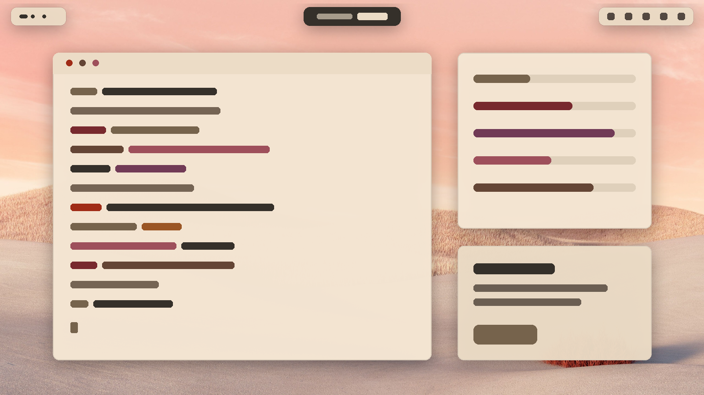 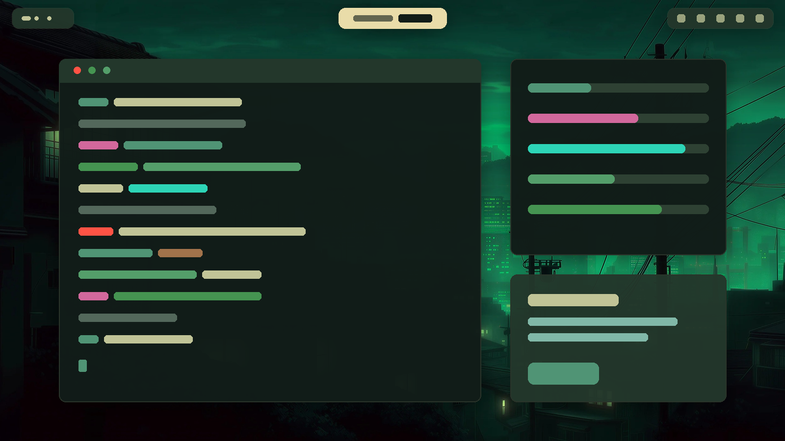

</div>

If you've seen [Omarchy](https://github.com/basecamp/omarchy) switch themes, you know
the feeling: hit a key, pick a theme, and everything changes at once. The terminal, the
editor, the browser, the wallpaper, all of it. dye brings that to a normal GNOME desktop.

Press <kbd>Super</kbd>+<kbd>Ctrl</kbd>+<kbd>Shift</kbd>+<kbd>Space</kbd>, scroll through
the carousel, hit Enter. GNOME Shell, GTK apps, the wallpaper, Ghostty, zsh, VS Code,
Zen, Claude Code, T3 Code and vicinae all switch together under one cross-fade. What's on
screen changes in about a tenth of a second.

dye reads Omarchy's theme format as is, so the whole Omarchy theme collection works: the
official themes and the community ones, straight from their git repos.

## Themes

Thirteen themes ship with dye. Light ones are marked ☀.

<table>
  <tr>
    <td align="center">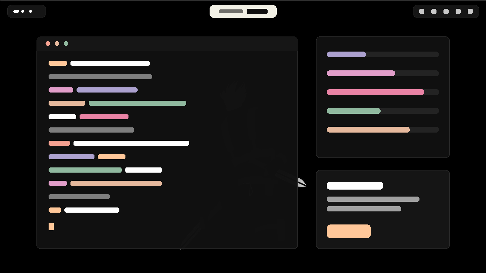<br><b>Vesper</b></td>
    <td align="center">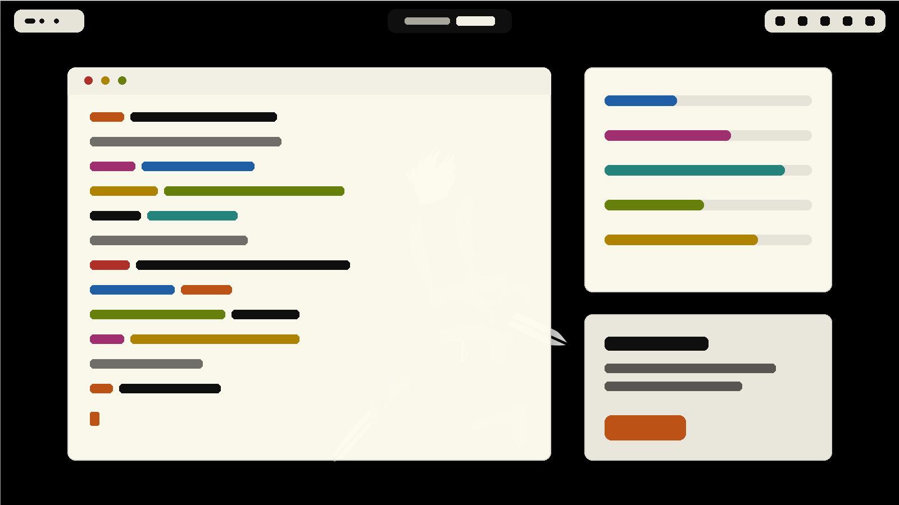<br><b>Flexoki Light</b> ☀</td>
    <td align="center"><br><b>Osaka Jade</b></td>
  </tr>
  <tr>
    <td align="center"><br><b>Rose of Dune</b> ☀</td>
    <td align="center">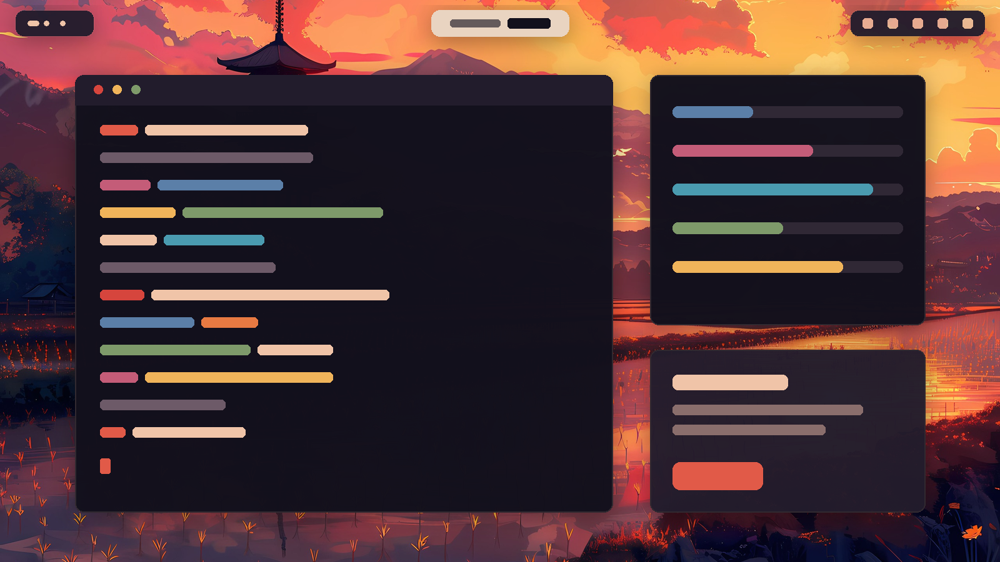<br><b>Akane</b></td>
    <td align="center">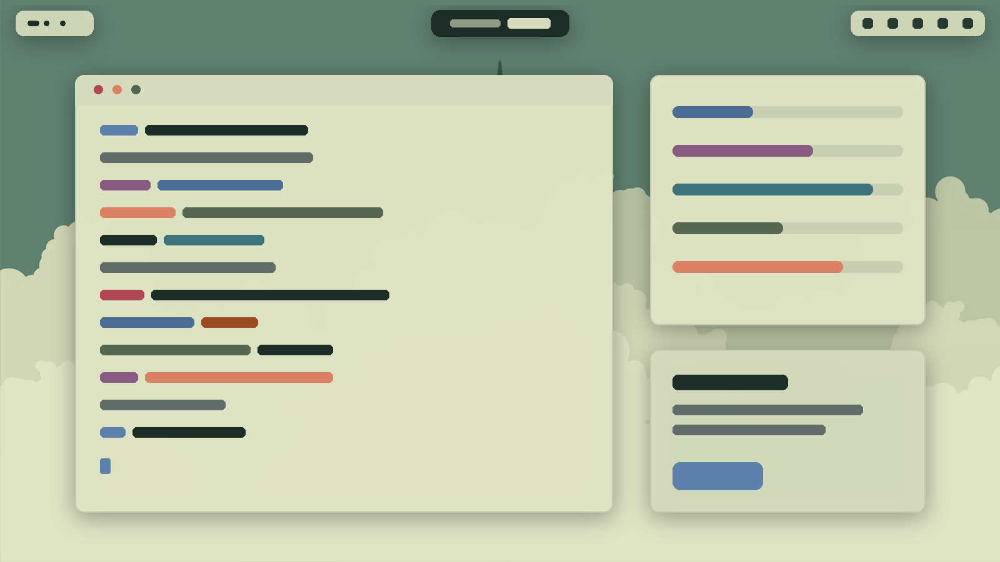<br><b>Harbor</b> ☀</td>
  </tr>
  <tr>
    <td align="center">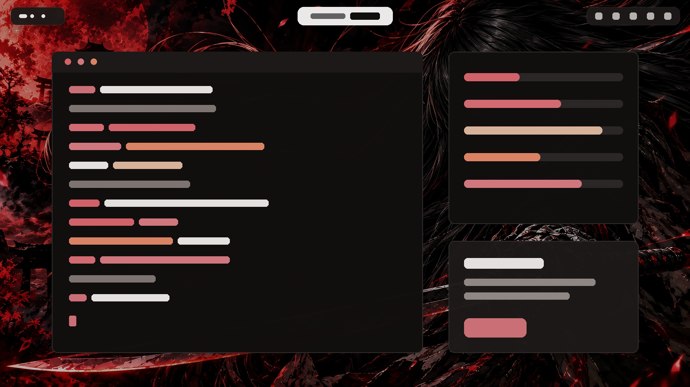<br><b>Emberveil</b></td>
    <td align="center">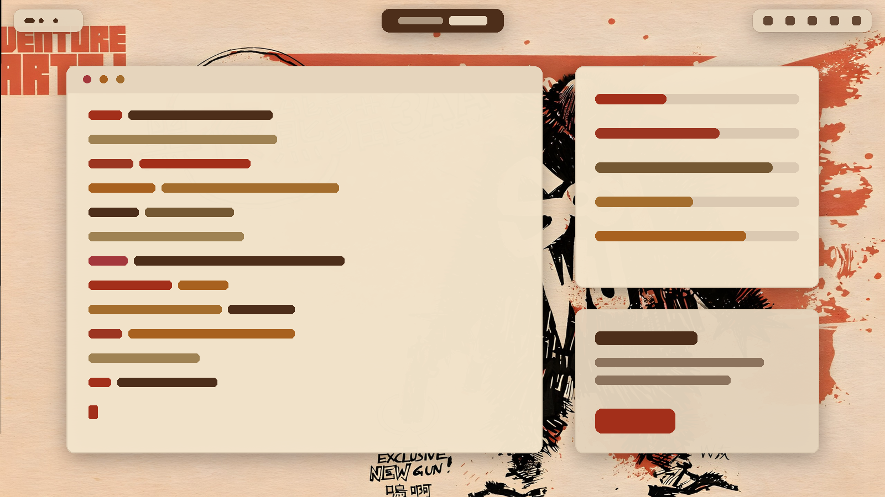<br><b>Akaito</b> ☀</td>
    <td align="center">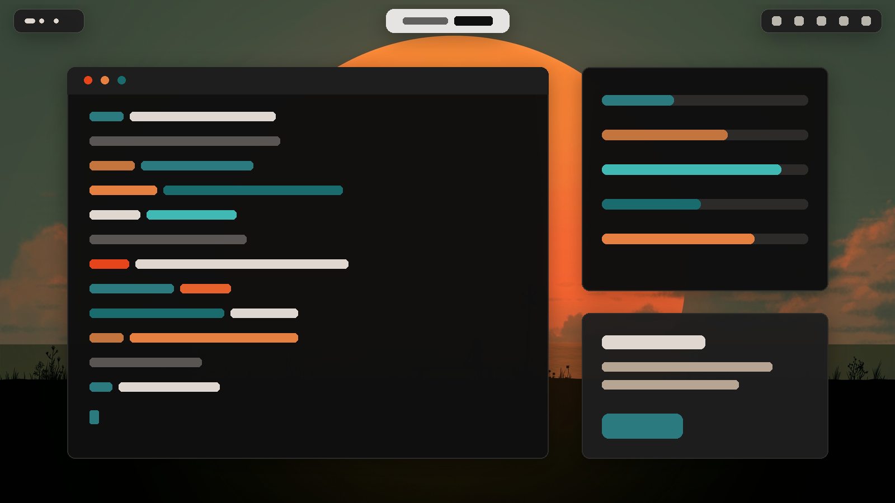<br><b>Firesky</b></td>
  </tr>
  <tr>
    <td align="center">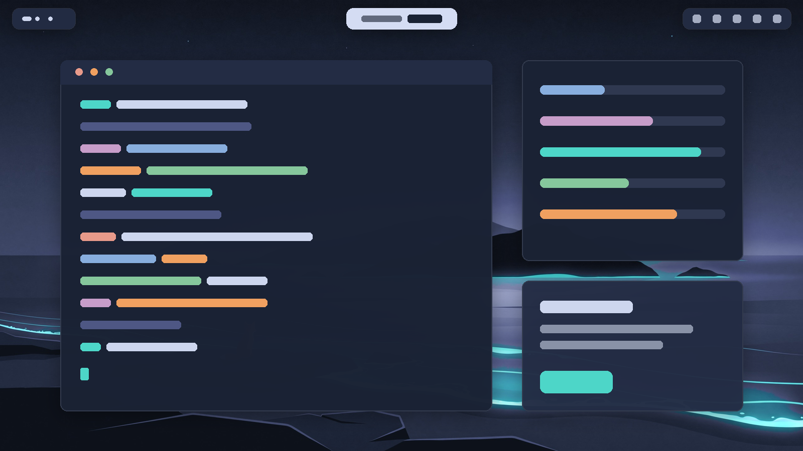<br><b>Fuchsblau</b></td>
    <td align="center">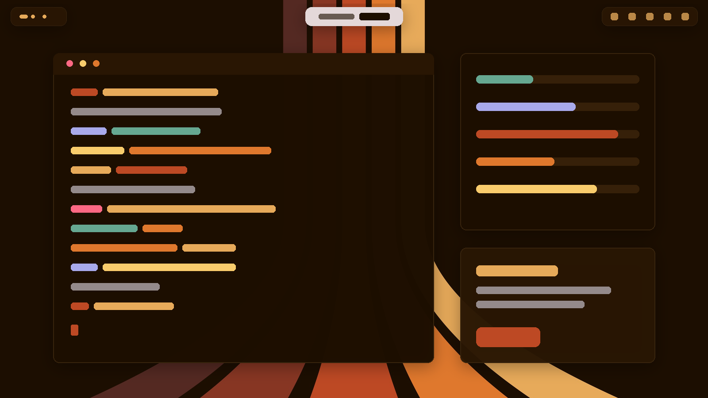<br><b>Space Monkey</b></td>
    <td align="center">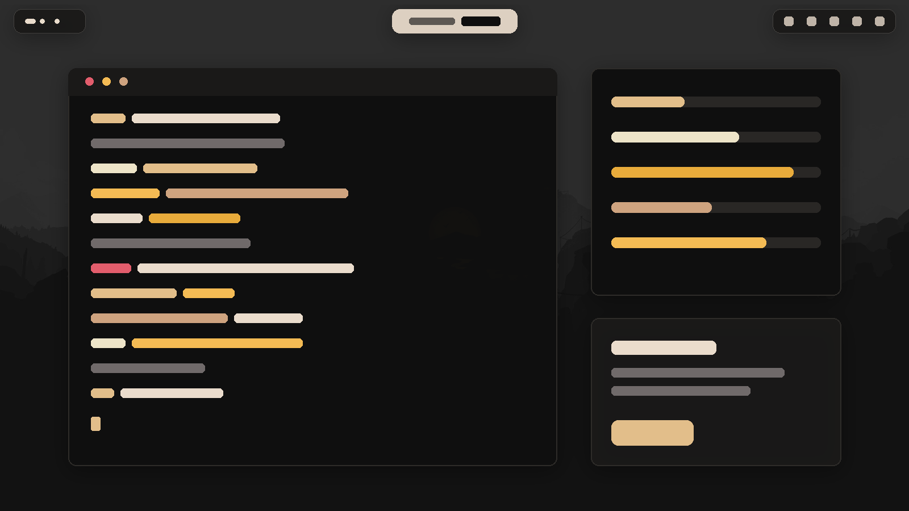<br><b>Aamis</b></td>
  </tr>
  <tr>
    <td align="center">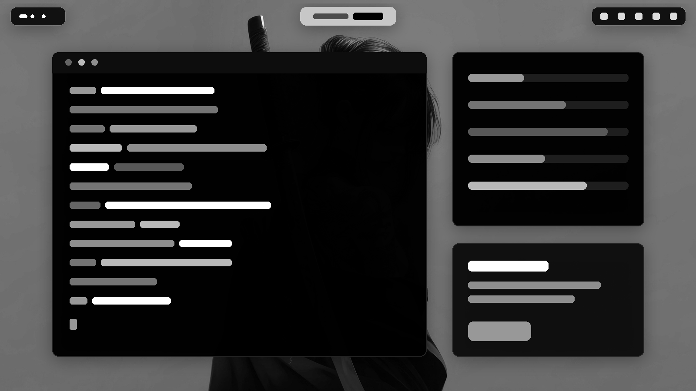<br><b>Black Arch</b></td>
    <td></td>
    <td></td>
  </tr>
</table>

Want more? `dye theme import-omarchy` brings in Omarchy's own themes, and any community
theme installs from its repo:

```sh
dye theme install https://github.com/someone/omarchy-cool-theme
```

## Getting started

You'll need:

- **GNOME Shell 50**. dye was built on Ubuntu 26.04, and it uses Ubuntu's **Yaru** shell
  theme as the base for the recoloured shell.
- **Python 3.11 or newer** and **git**. dye is plain Python with no packages to install.
- Optional: `python3-pil` for theme thumbnails in the picker,
  [vicinae](https://github.com/vicinaehq/vicinae) for launcher commands, and
  [Aether](https://github.com/bjarneo/aether) for making themes from a wallpaper.

Then:

```sh
git clone <this repo> ~/dye
cd ~/dye
./install.sh
```

Log out and back in once. GNOME only loads new shell extensions at login. After that
you're set:

```sh
dye theme set osaka-jade      # display names work too: dye theme set Rose of Dune
```

The installer is safe to run again. Before it changes anything, it backs up every config
dye will touch (more on that [below](#your-configs-are-safe)). Finally it runs
`dye doctor`, which shows you what's wired up and what isn't.

## Day to day

| | |
| --- | --- |
| <kbd>Super</kbd>+<kbd>Ctrl</kbd>+<kbd>Shift</kbd>+<kbd>Space</kbd> | Theme picker. ← → to browse, type to filter, Enter to apply, Del to remove, Esc to close. |
| <kbd>Super</kbd>+<kbd>Ctrl</kbd>+<kbd>Space</kbd> | Background picker for the current theme. |
| Quick Settings → Dark Style | Flips to your light or dark theme. dye remembers your last pick for each. |
| vicinae | Pick Theme, Next Theme, Set Theme, Next Background, Install Theme, Dye Doctor… |

Everything else is on the command line:

```text
dye theme list | current | set <name> | next | prev | picker | refresh
dye theme install <git url> | remove <name> | update | import-omarchy [--all|--list]
dye theme new <name> [--from <theme>] [--image <wallpaper> [--light]] [--edit]
dye theme preview [<name>]
dye bg next | prev | set <file> | picker | open | list
dye mode toggle | dark | light | status
dye bar compact | normal | status
dye apply <app>...      re-apply the theme to just these apps (e.g. dye apply ghostty vscode)
dye doctor              check that every app is wired up
dye settings            create ~/.config/dye/settings.toml and print its path
```

## What changes when you switch

| App | What dye does |
| --- | --- |
| **GNOME Shell** | The dye-shell extension recolours the shell and sets the colour scheme, accent colour and wallpaper in one go. It also gives you a floating top bar. |
| **GTK 4 / libadwaita** | Writes both the light and dark palettes, so open apps follow the Dark Style toggle live. |
| **GTK 3 and icons** | GTK 3 colours, plus Colloid icons in the theme's accent colour. |
| **Ghostty** | Colours from the theme. Open windows reload on their own. |
| **zsh** | Syntax-highlighting colours update before your next prompt. |
| **VS Code** | The theme's own VS Code theme if it names one, otherwise a generated "Dye" theme. |
| **Claude Code, T3 Code** | A generated theme for each. Every `~/.claude*` account gets one. |
| **Zen** | `userChrome.css` and `userContent.css` in every profile, native or Flatpak. |
| **vicinae** | A generated launcher theme. |
| **Tiling Assistant** | The focus outline in the accent colour. |

Only the shell, wallpaper and terminal hold up the command. The rest finishes in the
background, and if something goes wrong you get a notification and a line in
`~/.local/state/dye/theme-set.log`. Pass `--wait` to watch it all finish.

Omarchy themes often ship files for kitty, btop, Neovim and so on. dye keeps those in
the theme but doesn't apply them for now.

<details>
<summary>The two lines install.sh adds to your configs</summary>

Ghostty and zsh load the theme from a file dye keeps up to date, so each needs one
include. `install.sh` adds it if it's missing. Your Ghostty config gets:

```
config-file = ?~/.local/state/dye/current/theme/ghostty.conf
```

and the end of your `~/.zshrc` gets:

```zsh
# dye: syntax-highlighting colours follow the theme
_dye_zsh() {
  local f=~/.local/state/dye/current/theme.generation g
  [[ -r $f ]] && g=$(<$f) || return 0
  [[ $g == ${_dye_gen-} ]] && return 0
  _dye_gen=$g
  source ~/.local/state/dye/current/theme/zsh-highlight.zsh 2>/dev/null
}
autoload -Uz add-zsh-hook && add-zsh-hook precmd _dye_zsh
```

</details>

## Settings

Run `dye settings` to get a commented `~/.config/dye/settings.toml`. In it you can pick
which themes the Dark Style toggle switches between, choose Colloid or the theme's own
icons, turn off the shell cross-fade, and stop dye from touching any app you'd rather
theme yourself:

```toml
[apps]
vscode = false
```

## Make your own theme

A theme is just a folder with a `colors.toml`. Everything else is optional, and dye
fills in whatever's missing from the palette.

```sh
dye theme new my-theme --from vesper --edit      # start from a theme you like
dye theme new my-theme --image ~/Pictures/wall.jpg   # or pull a palette from a wallpaper (needs Aether)
```

Your themes live in `~/.config/dye/themes`. A folder there with the same name as a
stock theme overrides it file by file, so you can tweak one colour without forking the
whole theme. [docs/themes.md](docs/themes.md) covers the format.

Two more ways to customise:

- **Templates**: drop a `*.tpl` in `~/.config/dye/themed/` to override how dye renders
  any app's file.
- **Hooks**: executable scripts named `theme-set*` in `~/.config/dye/hooks/` run after
  every switch, with the theme name as the argument.

## Your configs are safe

dye edits other apps' settings files, so it's careful about it:

- **Backed up first.** Before the first switch, `install.sh` saves every config dye will
  edit, plus your GNOME settings, to `~/.local/state/dye/backup`. Only you can read it.
  `restore.sh` there puts everything back exactly, including files that are symlinks
  into your dotfiles.
- **Surgical edits.** dye changes only its own keys and keeps your comments and
  everything else in the file. If a file won't parse, dye leaves it alone and tells you.
- **No half-applied themes.** Each switch builds a complete new theme folder and then
  swaps one symlink, so apps never see a theme that's half written.
- **Untrusted themes stay untrusted.** A theme installed from git can't run code. dye
  never copies scripts, executables, symlinks or app configs that can run commands. It
  never takes shell CSS from a git theme either; it generates that from the palette.
  Every palette value must be a real colour, so nothing else can sneak into your
  configs. Git itself runs with hooks and prompts off.

### Uninstalling

```sh
./uninstall.sh --dry-run    # see what it would change
./uninstall.sh
```

This undoes only what dye did. Each setting it changed goes back to its old value, the
files it added are removed, the Ghostty and zsh lines come out, and GNOME gets its old
colours, icons and wallpaper back. Anything you changed yourself since installing stays.
The backup stays too, unless you add `--purge`.

## Hacking on dye

```sh
python3 -m unittest discover -s tests    # about 6 seconds; never touches your desktop
```

The tests run dye in a throwaway home folder with GNOME settings in memory, so they're
safe to run anywhere. To see how it all fits together, start with
[docs/architecture.md](docs/architecture.md). [docs/apps.md](docs/apps.md) shows how to
add an app.

```text
bin/dye        the command                 lib/dye/      the engine
extension/     the GNOME Shell extension   templates/    per-app templates
themes/        the stock themes            tests/        the test suite
vicinae/       launcher commands           docs/         how it works
```

## Credits

dye stands on [Omarchy](https://github.com/basecamp/omarchy): the theme format, the
palette rules, the template syntax and several templates come from it (MIT, see
`templates/LICENSE.omarchy`).

The stock themes are ports of other people's work. Thank you to their authors:
[Vesper](https://github.com/raunofreiberg/vesper),
[Flexoki](https://stephango.com/flexoki),
[Osaka Jade](https://github.com/basecamp/omarchy),
[Rose of Dune](https://github.com/HANCORE-linux/omarchy-roseofdune-theme),
[Harbor](https://github.com/HANCORE-linux/omarchy-harbor-theme),
[Akane](https://github.com/Grenish/omarchy-akane-theme),
[Emberveil](https://github.com/amaurisd97/omarchy-emberveil-theme),
[Firesky](https://github.com/bjarneo/omarchy-firesky-theme),
[Fuchsblau](https://github.com/fuchsblau/omarchy-fuchsblau-theme),
[Space Monkey](https://github.com/TyRichards/omarchy-space-monkey-theme),
[Aamis](https://github.com/vyrx-dev/omarchy-aamis-theme) and
[Black Arch](https://github.com/ankur311sudo/black_arch).
Each theme folder keeps its upstream licence where it has one.
